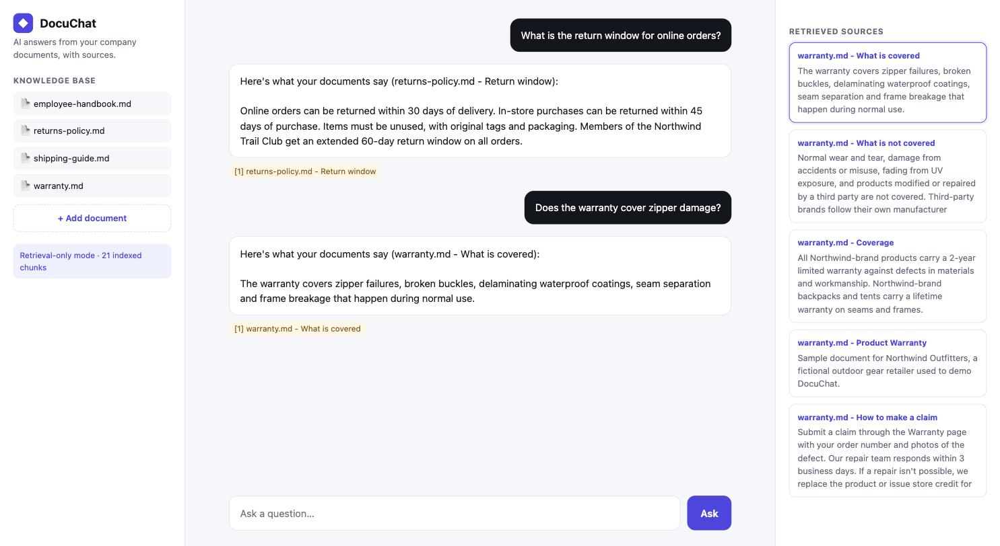

# DocuChat: AI chatbot that answers from your documents

A retrieval-augmented generation (RAG) assistant that answers questions from a company's own documents (policies, SOPs, manuals) and **cites the exact passage behind every answer**.



## Features
- Load Markdown, text and PDF documents, or upload new ones from the UI
- Section-aware chunking with overlap, so answers keep their context
- BM25 keyword retrieval with zero external services (no vector database needed for small and medium knowledge bases)
- Answers generated by Claude (`claude-opus-5-5`) with the API's built-in **citations**, so every claim links back to its source
- Says "I don't know" instead of guessing when the documents don't cover the question
- Retrieval-only mode when no API key is set, for offline demos
- Server-side refusal fallback enabled, so a declined request is retried on a fallback model in the same call

## Quick start
```bash
pip install -r requirements.txt
export ANTHROPIC_API_KEY=your-key   # optional: without it the app runs in retrieval-only mode
python app.py
```
Open http://localhost:8000 and try the sample questions. The `sample_docs/` folder contains documents for a fictional retailer, Northwind Outfitters; replace them with your own files.

## How it works
1. **Ingest**: documents are split on headings, then into ~900-character chunks with 150 characters of overlap.
2. **Retrieve**: the question is scored against every chunk with BM25 and the top 5 chunks are selected.
3. **Answer**: the chunks are sent to Claude as citable documents. The response comes back with citations pointing to the exact text used, which the UI shows as source chips and highlights in the sources panel.

## Production upgrades
For larger knowledge bases this design swaps in embeddings + a vector database (pgvector, Pinecone or Qdrant), hybrid search with reranking, access control per document, sync from Google Drive/Notion/SharePoint, and an evaluation set to measure answer accuracy.

## Project layout
```
app.py            HTTP server and API (stdlib only)
rag.py            chunking, BM25 retrieval and Claude answering
static/index.html chat UI
sample_docs/      demo knowledge base
```
